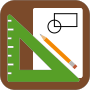
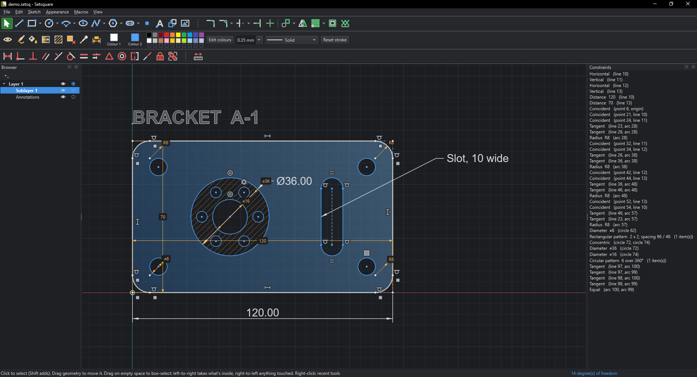

  

<h1 align="center">Setsquare</h1>

  A 2D parametric drawing app: sketch precisely with constraints and dimensions, then colour it in.

  <a href="https://github.com/notasandwich532/setsquare/releases/latest"><b>Download for Windows</b></a>

Setsquare is a 2D drawing app built around Fusion-style constrained sketching. You draw roughly, then pin the drawing down with constraints (parallel, tangent, equal…) and dimensions, and the solver (FreeCAD's PlaneGCS) keeps everything exact as you change it. On top of that it has fills, gradients, hatches, strokes and text, so the same drawing can be a precise technical part or a finished, coloured illustration. Everything can also be scripted in Python. Dark mode by default.

## Getting it
Download `Setsquare.zip` from the [latest release](https://github.com/notasandwich532/setsquare/releases/latest), unzip it anywhere and double-click `setsquare.exe`. Nothing needs installing (64-bit Windows 10 or 11). The app isn't code-signed, so the first time Windows may say "Windows protected your PC": click **More info**, then **Run anyway**.

## Features

### Sketching
- **Shapes:** lines, points, rectangles (two-corner, three-point and centred), circles (centre, two-point, three-point, tangent to two or three curves), arcs (centre, three-point, tangent), ellipses, splines (through points, or by control points), regular polygons and five kinds of slot.
- **Constraints:** coincident, horizontal/vertical, parallel, perpendicular, tangent, equal, ratio, midpoint, concentric, symmetric, collinear and fix.
- **Dimensions** that drive the drawing: lengths, distances, radii, diameters and angles. Typing a new value reshapes the drawing to fit, and values accept arithmetic.
- **Parameters:** named values like `width = 120` that dimensions follow (`width / 2 + 3`). Parameters can use each other, and pattern counts, spacings and offsets can use them too; change one and the drawing updates.
- **Live solving:** drag anything and the rest follows as the constraints allow. The status bar counts the remaining degrees of freedom, and conflicting constraints are highlighted.
- **Construction geometry** for guides that aren't part of the finished drawing.

### Editing
- **Trim, extend and break** at intersections, including ellipses and splines.
- **Fillet and chamfer** (equal distances, two distances, or distance and angle). The original corner stays as construction, so dimensions to it survive.
- **Move/Copy** with distances and rotation about any point, plus **scale** and **mirror**. Text goes along, turning with the rest; mirrored, it stays readable.
- **Rectangular and circular patterns, offset and divide**, all kept linked: change the count or spacing later and the copies update. Patterns repeat text too, each copy following its original.
- **Groups**, copy and paste.

### Appearance
- **Fills** that work like a paint bucket but follow the geometry: they leave holes unfilled and reshape when the outline moves.
- **Gradients**, linear and radial, tied to points in the drawing, for fills, strokes and text.
- **Hatching** with standard patterns, at any angle, scale and line weight.
- **Strokes:** colour, width and dash style for any curve.
- **Text** in any installed font: bold and italic, in a box, or following a line, arc or circle. Merged outlines for script fonts.
- **Colour palette and eyedropper.**
- **Presentation view** to see the drawing as it will be exported, without the sketching aids.

### Organising
- **Layers and sublayers.** Geometry can be projected from one layer into another and stays linked.
- **Reference images** to trace over, scaled to real size with Calibrate.
- **Page setup:** paper size, orientation and colour.

### Annotating and measuring
- **Drawing annotations:** aligned, horizontal, vertical, radius, diameter, angle, arc length and ordinate dimensions, and leader notes.
- **Measure** lengths, distances and areas.

### Files
- **Autosave and crash recovery:** unsaved work is copied aside every minute and offered back if the app closes unexpectedly.
- **Open Recent** for the last ten drawings, and .setsq files open with a double-click.
- **Import** SVG and DXF drawings, keeping their curves, strokes, fills and layers (and an SVG's page, if you like).
- **Export** SVG, DXF (exact curves, for CAD and CAM, on your layers), PDF (true size, with real text), and PNG or JPG at any resolution.

### Python scripting
- Everything in the app can be done from Python, with Python bundled (no install needed).
- Run it in the built-in **console**, as **macros**, or headless with `setsquare-cli script.py`.
- Every action in the UI is **recorded as Python**, so a drawing's history can be read, replayed or turned into a macro.

See [docs/scripting.md](docs/scripting.md) for the API.

## Building from source
Setsquare is C++20 with Qt 6, built with CMake and vcpkg (presets in `CMakePresets.json`). It's made for Windows; it can be compiled for Linux too, but it isn't built or tested there, so it may need small fixes.

## Credits
Setsquare was developed with [Claude](https://www.anthropic.com/claude), Anthropic's AI model, working in [Claude Code](https://www.anthropic.com/claude-code). The design, the decisions and the testing in use are the author's; Claude wrote all of the code, to that direction.

The constraint solver is PlaneGCS, from [FreeCAD](https://www.freecad.org)'s Sketcher.

## Licence
Setsquare is free software under the [GNU General Public License v3.0 or later](LICENSE). It's built on PlaneGCS (from FreeCAD, LGPL-2.1-or-later), Qt (LGPL-3.0), Python and other libraries: see [THIRD_PARTY_NOTICES.md](THIRD_PARTY_NOTICES.md). The Windows zip includes all of their licence texts.
